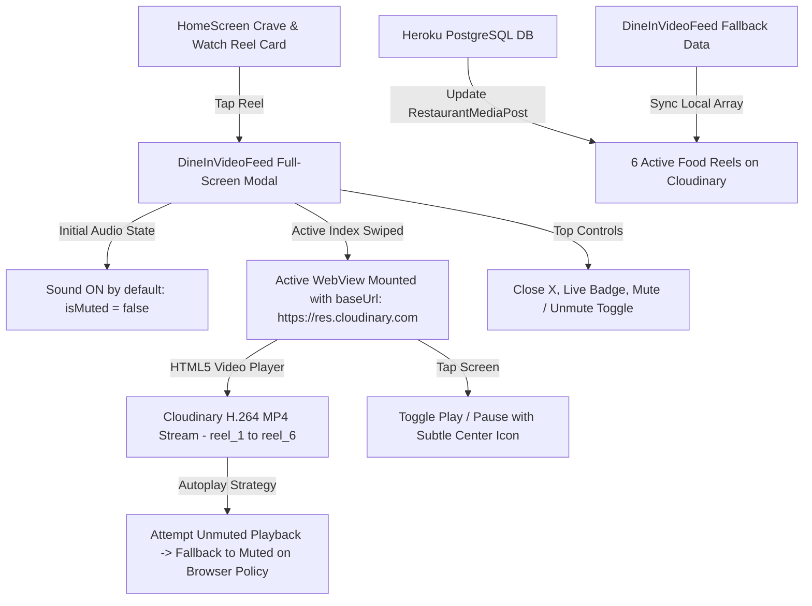

# Crave & Watch (Live Reels) Video Playback Engine Design

> **Date:** 2026-11-04  
> **Status:** APPROVED BY USER (Brainstorming Complete)  
> **Target Platform:** React Native (Expo) Customer Mobile App + Django REST Backend  
> **Affected Files:** `app/src/components/DineInVideoFeed.tsx`, `backend/restaurants/management/commands/seed_restaurant_data.py`, `backend/restaurants/models.py`

---

## 1. Executive Summary & Root Cause Diagnosis

### The Problem
When users open a reel in "Crave & Watch (Live Reels)" on the mobile app, none of the videos play. Some items render a static thumbnail while others show a black screen.

### Root Cause
1. **HTTP 403 Forbidden on Legacy URLs:** Both the Heroku PostgreSQL database (`RestaurantMediaPost` table) and the mobile frontend fallback array in `DineInVideoFeed.tsx` (lines 86, 111, 136, 161, 186, 211) pointed to Google sample video URLs:
   `https://commondatastorage.googleapis.com/gtv-videos-bucket/sample/WhatCarCanYouGetForAGrand.mp4`
   Google Cloud Storage has permanently locked this bucket, returning `HTTP 403 Forbidden` on all requests.
2. **WebView Autoplay & Security Boundary:** Without a valid HTTPS `baseUrl` (`https://res.cloudinary.com`) in the WebView source, Android WebView restricts inline video streams from remote CDNs.
3. **Audio Autoplay Policy:** Android Chromium restricts unmuted autoplay if no user interaction has occurred within the WebView frame.

---

## 2. Solution Architecture

---

## 3. Verified Cloudinary Video CDN Assets

The following 6 verified food video reels are hosted on the project's Cloudinary account (`qodsfm34`) and verified returning **HTTP 200 `video/mp4;codecs=avc1`**:

| Reel ID | Associated Restaurant / Dish | Cloudinary Secure MP4 URL | File Size |
|---|---|---|---|
| **Reel 1** | Blue — Luxury Coastal Steam Seafood Platter | `https://res.cloudinary.com/qodsfm34/video/upload/v1793799315/foodsphere/reels/reel_1.mp4` | 9.0 MB |
| **Reel 2** | Blue — Golden Kunafa Prawns Sizzle | `https://res.cloudinary.com/qodsfm34/video/upload/v1793799316/foodsphere/reels/reel_2.mp4` | 788 KB |
| **Reel 3** | Tandoori Stop — Clay Oven Melting Cheese Naan Pull | `https://res.cloudinary.com/qodsfm34/video/upload/v1793799317/foodsphere/reels/reel_3.mp4` | 991 KB |
| **Reel 4** | Tandoori Stop — Smoky Charcoal BBQ Platter | `https://res.cloudinary.com/qodsfm34/video/upload/v1793799319/foodsphere/reels/reel_4.mp4` | 27.9 MB |
| **Reel 5** | Jushh PK — Loaded Chicken Doner Feast Box | `https://res.cloudinary.com/qodsfm34/video/upload/v1793799321/foodsphere/reels/reel_5.mp4` | 41.3 MB |
| **Reel 6** | Jushh PK — Full Dubai Shawaya with Fragrant Rice | `https://res.cloudinary.com/qodsfm34/video/upload/v1793799324/foodsphere/reels/reel_6.mp4` | 6.1 MB |

---

## 4. Key Decisions & Technical Specifications

1. **Audio Policy (Sound ON Default):**
   - Modal initializes with `isMuted = false`.
   - HTML player runs an unmuted `.play()` call. If rejected by Android Chromium autoplay security sandbox, it catches the rejection, sets `vid.muted = true`, starts playback smoothly, and allows user to unmute with 1 tap on the speaker icon.
2. **TikTok / Reels Tap-to-Pause/Play:**
   - 1-tap anywhere on the video player sends a message or toggles playback, displaying a brief, semi-transparent center pause/play indicator that fades out.
3. **Database Migration & Backend Synchronization:**
   - Update `seed_restaurant_data.py` with the 6 Cloudinary reel URLs.
   - Run a live migration script on Heroku PostgreSQL to update all 6 existing `RestaurantMediaPost` rows immediately.
4. **Offline / Cold Start Resilience:**
   - Update `FALLBACK_POSTS` in `DineInVideoFeed.tsx` with identical Cloudinary URLs, guaranteeing immediate, flawless playback even on zero-network cold boot.
